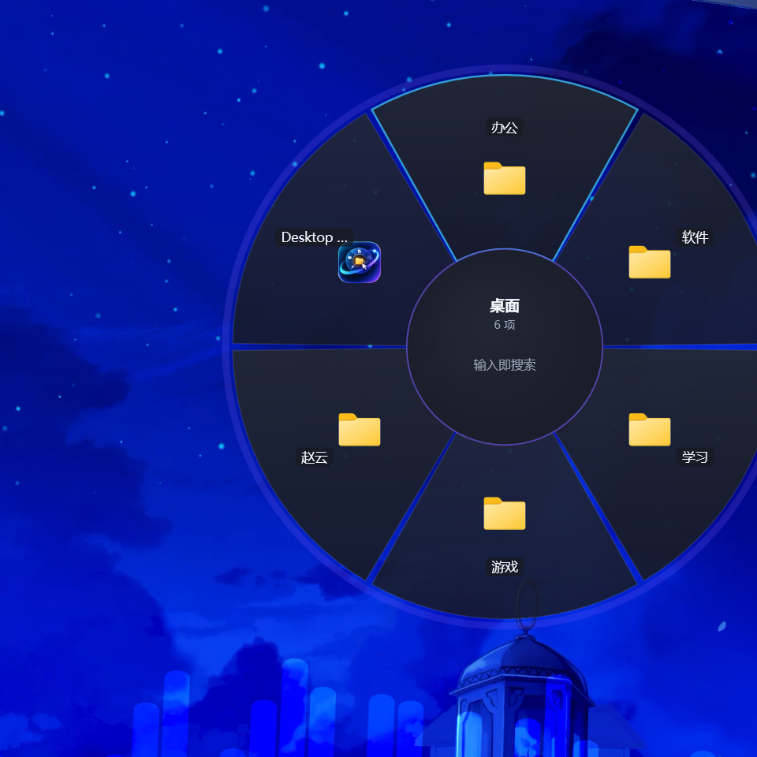
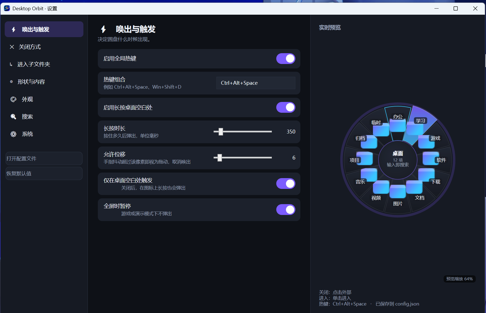

# Desktop Orbit · 桌面环形快捷菜单

[](LICENSE)
[](#系统要求)
[](https://dotnet.microsoft.com/)
[](#测试)

长按桌面空白处（或按热键），在光标处弹出一个环形菜单，直接浏览、打开、搜索和拖出桌面与自定义目录里的文件。

**不依赖桌面图标是否显示**——即使你关闭了「显示桌面图标」，菜单仍能完整列出文件。

<p align="center">
  
</p>

<p align="center">
  
</p>

---

## 功能

| 能力 | 说明 |
|---|---|
| **环形菜单** | 扇区对应文件夹或快捷入口，悬停放大，支持任意扇区数与半径 |
| **二级下钻** | 进入文件夹后显示其中的文件与子文件夹，可继续下钻，右键 / Esc 逐级回退 |
| **翻页** | 条目超过单环上限时折叠为 `+N`，翻页后回退先退页、再退文件夹 |
| **搜索** | 直接在圆盘里打字，结果卡片显示查询词与命中数量，`↑`/`↓` 选择、`Enter` 打开 |
| **拖出** | 从扇区把文件拖进资源管理器、微信、浏览器上传框等（`CF_HDROP`） |
| **最近使用** | 基于 frecency 排序的最近项 |
| **图标与缩略图** | 使用 Shell 图标接口，图片/视频取缩略图，带磁盘缓存 |
| **长按唤出** | 桌面空白处按住约 350ms 弹出，轮询实现，不安装全局钩子 |
| **全局热键** | 默认 `Ctrl+Alt+Space`，冲突时托盘提示 |
| **多种关闭方式** | 点击外部 / 移出自动关闭（死区时间 + 边缘缓冲）/ Esc / 失焦 |
| **图形化设置** | 分组导航 + 实时预览，改完即时生效并写回 `config.json` |
| **多屏与高 DPI** | Per-Monitor V2，按光标所在屏定位，异分辨率下不被裁切 |
| **轻量常驻** | 托盘图标，单实例，空闲 CPU 接近 0 |

<p align="center">
  
</p>

## 快速开始

### 直接使用

1. 到 [Releases](../../releases) 下载最新 `DesktopOrbit.exe`。
2. 双击运行，托盘出现图标即已就绪。
3. 按 `Ctrl+Alt+Space`，或在桌面空白处按住鼠标左键约 350ms。

单文件自包含版本约 67MB，**不需要安装 .NET 运行时**，可以单独复制到其他 Windows 机器直接运行。

### 操作

| 操作 | 效果 |
|---|---|
| 悬停扇区 / 左键单击 | 进入文件夹（可在设置里切换为仅单击） |
| 右键 / `Esc` / `Backspace` | 返回上一页或上一级；到顶后再按则关闭 |
| 直接打字 | 搜索，`↑` `↓` 选择，`Enter` 打开，`Tab` 拖出 |
| 在扇区上按住拖动 | 把文件拖到其他应用 |
| 滚轮 | 在当前环内移动选择 |
| 点击圆盘外部 | 关闭（可配置） |
| 托盘左键 / 右键 | 打开菜单 / 打开托盘菜单 |

### 命令行

```text
DesktopOrbit.exe              正常启动并常驻托盘
DesktopOrbit.exe --menu       直接唤出菜单（供 AutoHotkey / StreamDeck 调用）
DesktopOrbit.exe --settings   打开设置面板
DesktopOrbit.exe --render png 离屏渲染一张菜单图（用于视觉回归）
```

## 配置

配置文件位于 `%APPDATA%\DesktopOrbit\config.json`，首次启动自动生成。保存后自动热重载，无需重启。

大部分选项可用设置面板调整；需要批量修改或脚本化时直接编辑 JSON，字段完整说明见 [`docs/config.schema.json`](docs/config.schema.json)。

```jsonc
{
  "trigger": {
    "hotkey": "Ctrl+Alt+Space",
    "longPress": { "holdMs": 350, "requireBlankSpot": true }
  },
  "menu": {
    "outerRadiusDip": 240,      // 圆盘半径（DIP）
    "maxSectors": 12,           // 单环上限，超出折叠为「+N」
    "hoverDelayMs": 320,        // 悬停多久进入下一级
    "dismiss": {
      "closeOnClickOutside": true,   // 点击外部关闭
      "closeOnPointerLeave": false,  // 移出关闭
      "pointerLeaveDelayMs": 600     // 移出死区时间
    },
    "drill": { "onClick": true, "onHover": true },
    "showLabels": true,
    "labelMaxChars": 8
  },
  "appearance": {
    "accentColor": "#7C5CFF",
    "accentColor2": "#39C6FF",
    "iconSizeDip": 40,
    "animations": true,
    "glow": true
  },
  "sources": [
    { "id": "desktop",   "type": "desktop", "label": "桌面" },
    { "id": "downloads", "type": "folder",  "path": "%USERPROFILE%\\Downloads", "label": "下载" }
  ],
  "search": { "maxResults": 50, "maxDepth": 3, "maxIndexEntries": 20000 }
}
```

`path` 支持 `%USERPROFILE%` 等环境变量。`type` 可选 `desktop` / `folder` / `recent`。

## 从源码构建

需要 [.NET 8 SDK](https://dotnet.microsoft.com/download)。

```powershell
git clone https://github.com/weidudaiding/desktop-orbit.git
cd desktop-orbit

# 开发调试
dotnet build DesktopOrbit.sln
src\DesktopOrbit.App\bin\Debug\net8.0-windows\DesktopOrbit.exe

# 单文件自包含发布（推荐分发，产物在 dist\）
dotnet publish src/DesktopOrbit.App/DesktopOrbit.App.csproj -c Release -r win-x64 `
  --self-contained true -p:PublishSingleFile=true `
  -p:IncludeNativeLibrariesForSelfExtract=true -p:EnableCompressionInSingleFile=true `
  -o dist
```

## 测试

```powershell
dotnet test DesktopOrbit.sln
```

覆盖环形几何命中、翻页状态机、配置读写、模糊匹配、frecency、热键解析，以及设置面板每个参数与配置属性的映射一致性。

## 系统要求

- Windows 10 1809 及以上 / Windows 11（x64）
- 源码构建需要 .NET 8 SDK；直接使用发布的 exe 则无需任何运行时
- 不需要管理员权限

## 已知限制

- **无法拖入提权窗口**：Windows UIPI 限制，非提权进程不能向管理员权限窗口拖放，目标程序需同权限级别。
- **按项隐藏桌面图标**：Explorer 没有公开 API。目前提供「整层开关」（托盘菜单）与收纳目录（`general.vaultPath`）两种方式。
- **长按会透传一次点击**：不安装全局钩子，触发后那次 mouse-up 落到桌面，只会清除图标选中，属良性副作用。
- **空白处判定会降级**：精确判定依赖跨进程 `LVM_HITTEST`，若被安全软件阻止会自动降级为「按住时长 + 位移」，此时在图标上长按也会弹菜单。
- **搜索为本地索引**：枚举配置的根目录，深度受限。Windows Search / Everything 后端尚未接入。

## 项目结构

```text
src/DesktopOrbit.Core     配置模型、环形几何、导航栈、模糊匹配、frecency（无 UI 依赖，可单测）
src/DesktopOrbit.Shell    Win32 / COM 互操作、桌面定位、文件夹枚举、图标缓存、搜索、Shell 动作、托盘
src/DesktopOrbit.App      WPF 外壳：环形菜单绘制与交互、长按、热键、单实例、设置面板
tests/DesktopOrbit.Tests  xUnit 单元测试
docs/                     技术方案、配置 schema、截图
```

详细设计取舍（长按检测方案对比、拖拽细节、风险矩阵、里程碑）见 [`docs/TECH_DESIGN.md`](docs/TECH_DESIGN.md)。

## 致谢与参考

- Shell 图标：`IShellItemImageFactory`、`SHGetFileInfo`
- 拖放：`DoDragDrop` + `CF_HDROP`
- 高 DPI：Per-Monitor V2
- 相关 Windows API 文档见技术方案末尾的参考列表

## 许可证

[MIT](LICENSE) © 2026 weidudaiding
